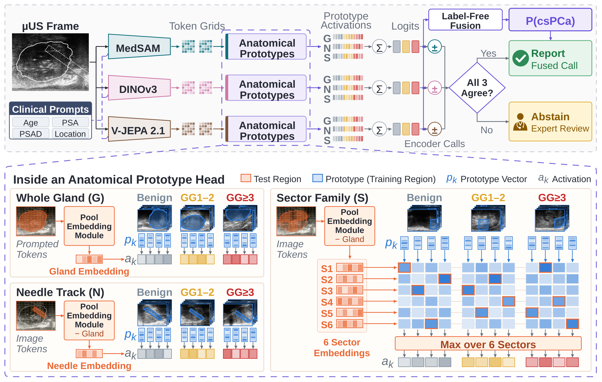
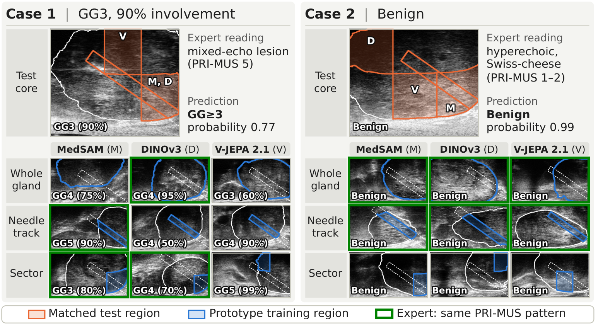
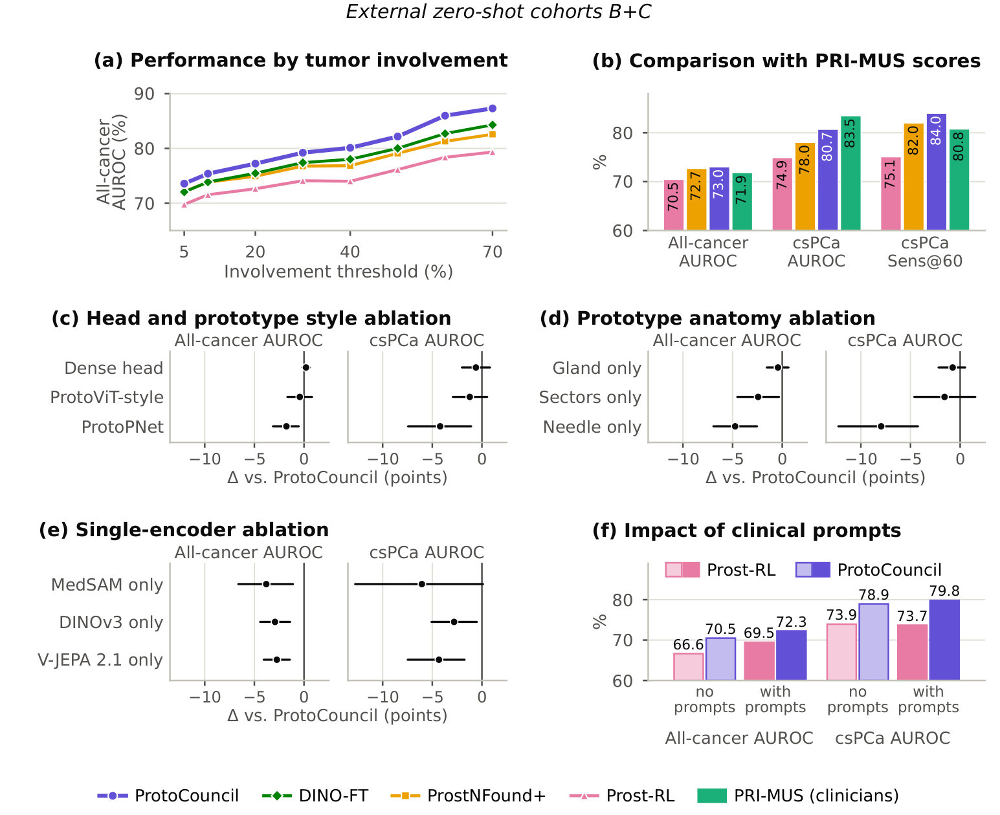

<div align="center">

<h1>ProtoCouncil: Multi-Encoder Anatomical Prototypes for Prostate Cancer Detection in Micro-Ultrasound</h1>

<p>
Mohammad Mahdi Abootorabi, Nooshin Maghsoodi, Armin Saadat, Obed Dzikunu, Zhuoxin Guo, <br>
Hannes Cash, Ferdinand Luger, Adam Kinnaird, Brian Wodlinger, Parvin Mousavi<sup>&#8224;</sup>, Purang Abolmaesumi<sup>&#8224;</sup>
</p>

<sub>&#8224; Co-senior authors.</sub>

[](https://arxiv.org/abs/2611.09058)
[](LICENSE)
</div>

ProtoCouncil detects prostate cancer in micro-ultrasound (µUS) biopsy cores with a decision process that can be traced to labeled training cases. Three foundation encoders (MedSAM, DINOv3 and V-JEPA 2.1) are fine-tuned as prompt-conditioned cancer detectors. On each encoder's token grids, an anatomical prototype head compares the whole gland, the needle track and six gland sectors of a core with class-specific prototypes that are projected onto real training regions. Every class logit is a bias plus an exact sum of weighted prototype similarities, and a label-free fusion of the three encoders keeps this structure. When the three encoders disagree, the council abstains and flags the core for expert review.



This repository contains the code to train ProtoCouncil on your own data and apply it to new cohorts: encoder adaptation, detector training, token extraction, anatomical prototype heads, projection, fusion, the disagreement gate, evaluation and case-based explanations.

## Contents

```
protocouncil/
  data.py            CSV manifest, patient-level folds, clinical-prompt scaling, image and mask preprocessing
  import_prostrl.py  use trained Prost-RL models as the MedSAM detector
  adapt.py           DINOv3 / V-JEPA 2.1 backbone adaptation with a dense involvement head
  train_detector.py  prompt-conditioned detector (heatmap involvement loss + three-class cross-entropy)
  extract.py         frozen detector(s) -> encoder (enc) and prompt-conditioned (ctx) token grids -> region descriptors
  train_heads.py     anatomical prototype head: training, projection onto training regions, final-layer refit
  council.py         label-free fusion, csPCa thresholds, encoder-disagreement gate, evaluation
  explain.py         per-core prototype contributions and their training exemplars
  models/            detector, encoders, prototype head; vendored SAM (Apache-2.0) and V-JEPA 2.1 (MIT) modules
research_detector/   exact training recipe of the paper's DINOv3 and V-JEPA 2.1 detectors (research code)
configs/             detector and backbone-adaptation settings for each encoder
scripts/             run_fold.sh (one fold, all stages) and run_all.sh (five folds + evaluation)
tests/               unit tests (CPU, no data or weights needed)
```

## Setup

Tested with Python 3.11, PyTorch 2.11 and CUDA 13. Detector training uses one GPU; the prototype heads train on CPU.

```bash
git clone https://github.com/DeepRCL/ProtoCouncil.git && cd ProtoCouncil
pip install -r requirements.txt
pip install -e .
# DINOv3 model code (only needed for the DINOv3 branch)
git clone https://github.com/facebookresearch/dinov3.git ../dinov3 && pip install -e ../dinov3
pip install pytest && pytest tests   # optional: unit tests on synthetic data
```

**Pretrained weights.** Put them in `checkpoints/` (or point `CKPT`, `MEDSAM`, `DINOV3` and `VJEPA` to them).

| Encoder | File | Source |
|---|---|---|
| MedSAM ViT-B | `medsam_vit_b.pth` | [MedSAM](https://github.com/bowang-lab/MedSAM) |
| DINOv3 ViT-L/16 (LVD-1689M) | `dinov3_vitl16_pretrain_lvd1689m-8aa4cbdd.pth` | [DINOv3](https://github.com/facebookresearch/dinov3) (access request) |
| V-JEPA 2.1 ViT-L/16 | `vjepa2_1_vitl_dist_vitG_384.pt` | [V-JEPA 2](https://github.com/facebookresearch/vjepa2) (`https://dl.fbaipublicfiles.com/vjepa2/vjepa2_1_vitl_dist_vitG_384.pt`) |

## Data

The clinical cohorts used in the paper are private and are not distributed. The code runs on any core-level µUS dataset described by a CSV manifest with one row per biopsy core:

| Column | Content |
|---|---|
| `core_id`, `patient_id`, `center` | identifiers; patient folds are stratified by `center` |
| `image` | B-mode frame of the core (grayscale `.png`/`.jpg`/`.tif` or 2-D `.npy`) |
| `prostate_mask`, `needle_mask` | binary prostate mask and needle-trace mask, same size as the image |
| `grade_group` | ISUP Grade Group 0-5 (0 = benign); empty for unlabeled cores |
| `involvement` | cancer involvement of the core as a fraction in [0, 1]; empty if unknown |
| `age`, `psa`, `psad` | clinical prompts; missing values are imputed with the training-split mean |
| `base_apex`, `mid_lateral` | core location: base -1 / mid 0 / apex 1, and medial 1 / lateral -1 |
| `fold` (optional) | patient fold; otherwise drawn with center-stratified patient-level 5-fold splitting |

Relative paths are resolved from the manifest's folder. Images of all cohorts should share one orientation (in our data the transducer is at the top row of the array). All-cancer is GG ≥ 1 and csPCa is GG ≥ 3. During training, benign cores of patients with cancer elsewhere are left out, as in ProstNFound+ and Prost-RL; validation folds keep every core. External cohorts use the same manifest format and are never used for training, selection or calibration.

## Training

`scripts/run_fold.sh` runs every stage for one fold, and `scripts/run_all.sh` runs the five folds, sets the thresholds and evaluates:

```bash
PROSTRL_SUP='prostrl/PPO-supervised-baseline-fold{fold}/best_rl.pth' \
PROSTRL_RL='prostrl/EXP4-pairwise-ranking-rl-fold{fold}/best_rl.pth' \
bash scripts/run_all.sh data/cohort_a.csv data/cohort_b.csv:cohort_b data/cohort_c.csv:cohort_c
```

The stages for fold `k`:

1. **Detectors.** Each foundation model is fine-tuned on the training folds as a prompt-conditioned cancer detector: image tokens and clinical prompt tokens meet in a decoder that predicts a cancer heatmap, supervised by core involvement inside the needle track, and in class decoders that predict cancer and csPCa. Each detector gives two 16×16 token grids: image features from the encoder (`enc`) and prompt-conditioned features from the class decoder (`ctx`). Every route below ends with a `ctx.pth` and an `enc.pth` per encoder and fold.
   - **MedSAM: Prost-RL.** As in the paper, the MedSAM branch uses [Prost-RL](https://github.com/DeepRCL/Prost-RL). Train it for each fold with the same patient folds, following its README (supervised warm-up, then the RL stage). Then import both checkpoints: the supervised one gives the context grid and the RL one the encoder grid.
     ```bash
     python -m protocouncil.import_prostrl --supervised prostrl/PPO-supervised-baseline-fold0/best_rl.pth \
         --rl prostrl/EXP4-pairwise-ranking-rl-fold0/best_rl.pth --fold 0 --out runs/detectors/medsam/fold0
     ```
     Without Prost-RL, `train_detector --config configs/detector_medsam.yaml` trains a ProstNFound+-style MedSAM detector (adapters only).
   - **DINOv3 and V-JEPA 2.1.** The backbone is first adapted with a dense involvement head (`protocouncil.adapt`). The detector is then trained on top of it, with its decoders initialized from the MedSAM detector of the same fold.
     ```bash
     python -m protocouncil.adapt --config configs/adapt_dinov3.yaml --weights checkpoints/dinov3_vitl16_pretrain_lvd1689m-8aa4cbdd.pth \
         --manifest data/cohort_a.csv --fold 0 --out runs/adapt/dinov3/fold0
     python -m protocouncil.train_detector --config configs/detector_dinov3.yaml --manifest data/cohort_a.csv --fold 0 \
         --medsam-checkpoint checkpoints/medsam_vit_b.pth --encoder-weights runs/adapt/dinov3/fold0/encoder.pth \
         --init-decoders-from runs/detectors/medsam/fold0/ctx.pth --out runs/detectors/dinov3/fold0
     ```
     This trains a minimal detector: the backbone, a three-class class decoder and the involvement heatmap. [`research_detector/`](research_detector) contains the exact recipe of the paper's DINOv3 and V-JEPA 2.1 detectors, which adds auxiliary training terms from our earlier experiments; select it with `DETECTOR=research` in the scripts.
2. **Region descriptors.** The detectors are frozen and their token grids are pooled over anatomical regions. The gland, needle track (needle trace ∩ gland) and six sectors (posterior/anterior halves by per-column depth × three equal-area thirds) are built from each core's own masks, and every region is described by the mean and the channel-wise maximum of its tokens.
   ```bash
   python -m protocouncil.extract --detector runs/detectors/medsam/fold0/ctx.pth --enc-detector runs/detectors/medsam/fold0/enc.pth \
       --manifest data/cohort_a.csv --out runs/packs/medsam/fold0 --external data/cohort_b.csv:cohort_b
   ```
   A detector trained with `train_detector` gives both grids: pass its `best.pth` as `--detector` and omit `--enc-detector`.
3. **Anatomical prototype heads.** For each encoder: 4 prototypes per family (gland, needle, sector) and class (36 in total), class-weighted cross-entropy with cluster, separation and diversity terms, gland-family dropout (p = 0.5), early stopping on the validation fold, projection of every prototype onto a real training region of a distinct patient (Hungarian assignment), and a refit of the final layer. We train two head seeds per fold.
   ```bash
   python -m protocouncil.train_heads --packs runs/packs/medsam/fold0 --seed 7201 --out runs/heads/medsam/fold0/seed7201
   ```
4. **Council.** Encoder logits are averaged with weights inversely proportional to each encoder's logit scale on the validation fold (no labels involved), and the two head seeds are averaged. Each encoder and the fused model call csPCa at their own 80%-specificity threshold, set on the pooled validation folds. The council reports the fused call when all three encoders agree and abstains otherwise.
   ```bash
   python -m protocouncil.council predict --heads runs/heads --packs runs/packs --fold 0 --split cohort_b --out runs/council/fold0/cohort_b.csv
   python -m protocouncil.council calibrate --predictions runs/council/fold*/val.csv --out runs/council/thresholds.json
   python -m protocouncil.council evaluate --predictions runs/council/fold*/cohort_b.csv --thresholds runs/council/thresholds.json
   ```
   `predict` writes the fused class probabilities (`p_cancer`, `p_cspca`) and each encoder's probabilities. `evaluate` reports the paper's metrics as mean ± SD over the fold models: all-cancer AUROC and sensitivity at 80% specificity, high-involvement AUROC, csPCa AUROC and sensitivity at 60%/80% specificity, patient-level csPCa AUROC, and selective prediction (coverage, balanced accuracy and AUROC of retained cores for the disagreement gate and for a confidence gate at the same coverage, and accuracy by the number of encoders that oppose the fused call).

To score a new cohort with trained models, describe it with a manifest (labels optional), run `extract --external new.csv:new` for each encoder and `council predict --split new`.

## Explanations

```bash
python -m protocouncil.explain --heads runs/heads --packs runs/packs --fold 0 --seed seed7201 --split val --core-id CORE_ID \
    --manifest data/cohort_a.csv --figure core.png
```

For the predicted class, the tool lists each encoder's largest prototype contributions with the matched test region, the similarity, the weight and the training core and region the prototype was projected onto, and checks that the contributions add up to the logits. With `--figure` it draws each test region next to its training exemplar.



## Results

Three cohorts, 8,606 cores from 846 patients: five-fold patient-level cross-validation on cohort A (6,588 cores, 693 patients) and zero-shot evaluation on two external cohorts (B: 1,460 cores, 111 patients, transrectal; C: 558 cores, 42 patients, transperineal). AUROC (%), mean over the five fold models:

| Method | A all | A csPCa | B all | B csPCa | C all | C csPCa |
|---|---|---|---|---|---|---|
| ProstNFound+ | 77.3 | 78.0 | 74.5 | 78.0 | 59.4 | 72.3 |
| Prost-RL | 78.1 | 78.6 | 72.5 | 75.4 | 56.5 | 65.1 |
| DINO-FT | 78.0 | 79.1 | 73.1 | 79.5 | 63.3 | 77.7 |
| **ProtoCouncil** | **81.3** | **82.9** | **74.9** | **80.0** | **63.6** | **79.5** |

Abstaining when any encoder disagrees retains 70%, 58% and 54% of the cores of cohorts A, B and C and raises csPCa balanced accuracy from 74.1 to 80.2, 72.4 to 79.0 and 70.3 to 84.8. All baselines and metrics are in the paper.



**Reproducibility.** Given the same token grids, the prototype heads, projection, fusion and disagreement gate in this repository reproduce the paper's models exactly. Loaded with the paper's trained detectors, `import_prostrl` (MedSAM via Prost-RL) and `research_detector` (DINOv3 and V-JEPA 2.1) reproduce the paper's region descriptors up to floating-point rounding, and the research trainer computes the same training objective as our original code. GPU training is not bit-reproducible, so retrained detectors will differ slightly from ours. The minimal DINOv3 / V-JEPA 2.1 detectors in `protocouncil` are simpler than the paper's; use `research_detector` for the exact recipe.

## Citation

```bibtex
@article{abootorabi2026protocouncil,
  title   = {ProtoCouncil: Multi-Encoder Anatomical Prototypes for Prostate Cancer Detection in Micro-Ultrasound},
  author  = {Abootorabi, Mohammad Mahdi and Maghsoodi, Nooshin and Saadat, Armin and Dzikunu, Obed and Guo, Zhuoxin and
             Cash, Hannes and Luger, Ferdinand and Kinnaird, Adam and Wodlinger, Brian and Mousavi, Parvin and
             Abolmaesumi, Purang},
  journal = {arXiv preprint arXiv:XXXX.XXXXX},
  year    = {2026}
}
```

## Acknowledgments

The detectors follow ProstNFound+ and [Prost-RL](https://github.com/DeepRCL/Prost-RL), the prototype layer follows [ProtoPNet](https://github.com/cfchen-duke/ProtoPNet), and the encoders come from [MedSAM](https://github.com/bowang-lab/MedSAM), [DINOv3](https://github.com/facebookresearch/dinov3) and [V-JEPA 2](https://github.com/facebookresearch/vjepa2). This work was supported in part by the Canadian Institutes of Health Research (CIHR), the Natural Sciences and Engineering Research Council of Canada (NSERC), the Vector Institute, and computational resources and services provided by Advanced Research Computing at the University of British Columbia. P. Mousavi is supported in part by a Canada CIFAR AI Chair and a Canada Research Chair.

## License

The code is released under the [MIT License](LICENSE). The vendored Segment Anything modules (`protocouncil/models/sam`) are under the Apache License 2.0 and the vendored V-JEPA 2.1 modules (`protocouncil/models/vjepa`) under the MIT License; see the license files in those folders. Pretrained MedSAM, DINOv3 and V-JEPA 2.1 weights keep their own licenses.
